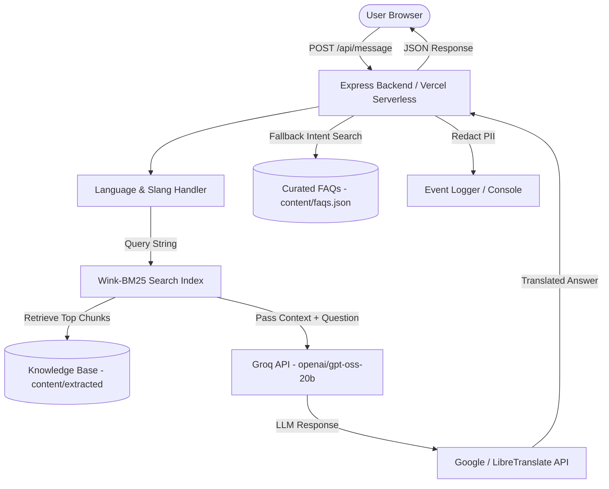

# SaarThi (Evergreen College Assistant)

> A multilingual, AI-powered conversational campus assistant for college navigation, academic schedules, admissions, and student support.

[](https://github.com/kiiiishan/saarthi.git)
[](https://saarthi-ashy.vercel.app)
[](package.json)

---

## Table of Contents

- [Overview](#overview)
- [Features](#features)
- [Screenshots](#screenshots)
- [Technology Stack](#technology-stack)
- [Architecture](#architecture)
- [Project Structure](#project-structure)
- [Prerequisites](#prerequisites)
- [Local Installation and Setup](#local-installation-and-setup)
- [Environment Variables](#environment-variables)
- [API Documentation](#api-documentation)
- [Search and AI Workflow](#search-and-ai-workflow)
- [Deployment on Vercel](#deployment-on-vercel)
- [Testing and Troubleshooting](#testing-and-troubleshooting)
- [Security and Privacy](#security-and-privacy)
- [Limitations and Future Improvements](#limitations-and-future-improvements)
- [License and Contribution](#license-and-contribution)

---

## Overview

**SaarThi** is an intelligent, multilingual campus assistant designed to help students, prospective applicants, and parents quickly access college information. Built for Evergreen College, SaarThi answers inquiries regarding academic calendars, mid-term schedules, admission requirements, fee structures, hostel accommodation, and campus events.

The application combines **BM25 full-text search**, **curated FAQ intent matching**, and **Groq LLM inference** (`openai/gpt-oss-20b`) to provide fast, context-aware responses in multiple Indian languages (English, Hindi, Bengali, Tamil, Marathi, and more).

- **GitHub Repository**: [https://github.com/kiiiishan/saarthi.git](https://github.com/kiiiishan/saarthi.git)
- **Production Live Demo**: [https://saarthi-ashy.vercel.app](https://saarthi-ashy.vercel.app)

---

## Features

- **Conversational Campus UI**: Interactive floating web widget with responsive design (Tailwind CSS) integrated directly into the college landing page.
- **Multilingual Knowledge Base Search**: In-memory BM25 text index (`wink-bm25-text-search`) that indexes raw academic documents and extracted text chunks.
- **Groq LLM Integration**: High-speed AI generation powered by Groq's Chat Completions API (`openai/gpt-oss-20b` or `llama-3.1-8b-instant`).
- **Curated Intent Matching**: Dual-layer retrieval using Levenshtein distance and Jaccard token similarity over curated multilingual FAQs (`content/faqs.json`).
- **Language Detection & Translation**: Automated Unicode script detection (Devanagari, Bengali, Tamil, etc.) with Google Translate API v2 and LibreTranslate fallback.
- **Privacy-Conscious Logging**: Automatic PII redaction (email addresses and phone numbers obfuscated before logging events).
- **Vercel Serverless Ready**: EROFS-aware runtime configuration that gracefully handles read-only serverless filesystems without crashing.

---

## Screenshots

*Include application interface previews here.*

| Landing Page & Assistant Widget | Live Chat Interaction |
|---|---|
|  *(Launch index.html to view)* |  *(Test live at saarthi-ashy.vercel.app)* |

> **Adding Screenshots**: Save interface screenshots into a `docs/images/` directory and update the Markdown image links above.

---

## Technology Stack

### Frontend
- **HTML5 & Vanilla JavaScript**: Lightweight single-page interface without heavy framework overhead.
- **Tailwind CSS (CDN)**: Modern utility-first CSS styling with custom animations and dynamic responsive design.

### Backend
- **Node.js (v16.0.0+)**: JavaScript runtime environment (tested up to `v24.13.0`).
- **Express.js (v4.19.2)**: Minimalist Web framework for API endpoints and static file serving.
- **Wink NLP & BM25 (`wink-bm25-text-search`, `wink-nlp-utils`)**: In-memory text search and tokenization engine for knowledge base retrieval.

### AI & Translation
- **Groq API**: OpenAI-compatible Chat Completions API for LLM inference (`openai/gpt-oss-20b`).
- **Hugging Face Inference API**: Secondary fallback provider for language models.
- **Google Translate API v2 / LibreTranslate**: Multilingual translation services.

### Infrastructure & Deployment
- **Vercel Serverless Functions**: Cloud host for Express backend routes (`api/index.js`) and static frontend deployment.
- **npm**: Package management.

---

## Architecture

The system uses a hybrid retrieval-augmented architecture:

1. **Input Processing**: The user submits a message via the frontend web widget.
2. **Language & Slang Normalization**: The backend identifies the user's language via Unicode block heuristics (`detectLang`) and expands common academic slang (`expandSlang`).
3. **BM25 Document Retrieval**: The query is searched against the `wink-bm25` index built from text files in `content/extracted/`.
4. **LLM Synthesis (Groq)**: Top-matching chunks are passed as context to the Groq Chat Completions API (`openai/gpt-oss-20b`).
5. **Fallback Intent Engine**: If retrieval or LLM inference fails, the query falls back to curated FAQ matching using Jaccard and Levenshtein token similarity algorithms.
6. **Translation & Response**: The response is translated back into the user's input language if necessary.
7. **PII Redaction & Logging**: Contact details (emails, phone numbers) are redacted before event logging.



---

## Project Structure

```
saarthi/
├── api/
│   └── index.js              # Vercel Serverless Function entrypoint wrapping Express app
├── content/
│   ├── draft_kb.json         # Draft Q&A dataset structure
│   ├── faqs.json             # Curated multilingual FAQ intents (EN, HI, BN, TA, MR)
│   └── extracted/
│       ├── 1.txt             # Extracted raw text chunk 1
│       └── 2.txt             # Extracted raw text chunk 2 (Academic Calendar)
├── tools/
│   ├── ingest.js             # PDF text extraction tool (pdf-parse)
│   ├── test_groq.js          # Groq API connectivity and response test script
│   └── test_hf.js            # Hugging Face API connectivity test script
├── .env.example              # Safe template for required environment variables
├── .gitignore                # Git exclusion rules for secrets, logs, node_modules
├── index.html                # Frontend single-page application and UI widget
├── package.json              # Project dependencies, scripts, and metadata
├── package-lock.json         # Locked dependency versions
├── README.md                 # Project documentation
├── server.js                 # Express server, BM25 search engine, and API routes
└── vercel.json               # Vercel route rewrites and serverless configuration
```

### Key File Descriptions

- `server.js`: Central application server implementing Express routes, Wink BM25 document indexing, Groq LLM integration, intent fallback, and PII-sanitized logging.
- `api/index.js`: Vercel serverless function entrypoint exporting the Express application.
- `vercel.json`: Directs incoming web and API traffic (`/api/*` and `/*`) to `api/index.js`.
- `index.html`: Responsive single-page application UI with Tailwind CSS and an interactive chat modal.
- `tools/ingest.js`: Utility script to parse source PDFs from `content/source_pdfs/` into `content/extracted/`.
- `tools/test_groq.js`: Diagnostic script to test Groq API connectivity without exposing secrets.

---

## Prerequisites

Before running SaarThi locally, ensure you have:

- **Node.js**: `v16.0.0` or higher (tested up to `v24.13.0`).
- **npm**: `v8.0.0` or higher.
- **Groq API Key**: A valid key from [Groq Console](https://console.groq.com) (for LLM responses).

---

## Local Installation and Setup

Run the following commands in **Windows PowerShell** or terminal:

### 1. Clone the repository
```powershell
git clone https://github.com/kiiiishan/saarthi.git
cd saarthi
```

### 2. Install dependencies
```powershell
npm install
```

### 3. Configure environment variables
Copy `.env.example` to create your local `.env` file:
```powershell
Copy-Item .env.example .env
```

Open `.env` in your text editor and insert your Groq API Key:
```env
PORT=3000
USE_LLM=true
GROQ_API_KEY=gsk_your_actual_groq_api_key_here
GROQ_MODEL=openai/gpt-oss-20b
```

### 4. Start the local server
```powershell
npm start
```
*or for development:*
```powershell
npm run dev
```

### 5. Access the application
Open your web browser and navigate to:
```
http://localhost:3000
```

---

## Environment Variables

| Variable Name | Purpose | Required? | Default / Safe Placeholder |
|---|---|---|---|
| `PORT` | Local HTTP server port | Optional | `3000` |
| `USE_LLM` | Enable/disable LLM inference calls | Optional | `true` |
| `GROQ_API_KEY` | Authentication key for Groq API | **Required** (for AI generation) | `your_groq_api_key_here` |
| `GROQ_MODEL` | Target Groq model identifier | Optional | `openai/gpt-oss-20b` |
| `HUGGINGFACE_API_KEY` | Authentication key for HF Inference API | Optional | `your_huggingface_api_key_here` |
| `HUGGINGFACE_MODEL` | Target Hugging Face model ID | Optional | `your_huggingface_model_id_here` |
| `GOOGLE_TRANSLATE_API_KEY` | API Key for Google Translate v2 | Optional | `your_google_translate_api_key_here` |
| `LIBRETRANSLATE_URL` | Self-hosted or public LibreTranslate endpoint | Optional | `https://libretranslate.com` |
| `LIBRETRANSLATE_API_KEY` | API Key for LibreTranslate instance | Optional | `your_libretranslate_api_key_here` |

> [!CAUTION]
> **Security Notice**: Never commit `.env` or hardcode API keys into source files. Server-side API keys (`GROQ_API_KEY`, `GOOGLE_TRANSLATE_API_KEY`) must remain strictly in environment variables and never be exposed to the browser client.

---

## API Documentation

### 1. Health Check
Returns system status, active FAQ count, and current server timestamp.

- **HTTP Method**: `GET`
- **Path**: `/api/health`
- **Request Body**: None
- **Response**: `200 OK`
```json
{
  "ok": true,
  "service": "saarthi-backend",
  "faqs": 15,
  "time": "2026-10-10T15:00:00.000Z"
}
```

---

### 2. Message Endpoint
Main conversational endpoint processing questions via BM25 retrieval, Groq LLM synthesis, or FAQ intent matching.

- **HTTP Method**: `POST`
- **Path**: `/api/message`
- **Request Headers**: `Content-Type: application/json`
- **Request Body**:
```json
{
  "sessionId": "guest-session-123",
  "message": "When are mid-term exams scheduled?",
  "lang": "en",
  "channel": "web"
}
```
- **Response**: `200 OK`
```json
{
  "reply": "Mid‑term exams are scheduled as follows:\n\n- **Mid Term‑1:** 6–10 Oct\n- **Mid Term‑2:** 17–21 Nov",
  "lang": "en",
  "intentId": null,
  "confidence": 3.62,
  "fallback": false,
  "sessionId": "guest-session-123"
}
```

---

### 3. List FAQs
Retrieves available curated FAQ intents and their supported translation languages.

- **HTTP Method**: `GET`
- **Path**: `/api/faqs`
- **Request Body**: None
- **Response**: `200 OK`
```json
{
  "count": 15,
  "faqs": [
    {
      "id": "btech_7sem_start",
      "title": "B.Tech 7th Sem Commencement",
      "languages": ["en", "hi", "bn", "ta", "mr"]
    }
  ]
}
```

---

### 4. Today's Logs
Streams interaction logs for the current date in NDJSON format (available in local file environments).

- **HTTP Method**: `GET`
- **Path**: `/api/logs/today`
- **Request Body**: None
- **Response**: `200 OK` (`application/x-ndjson`) or `404 Not Found` (on Vercel serverless runtime where local file logging is disabled).

---

### 5. Index Reload
Re-indexes knowledge base text files from `content/extracted/` into the Wink BM25 engine in memory.

- **HTTP Method**: `POST`
- **Path**: `/api/reload`
- **Response**: `200 OK`
```json
{
  "ok": true,
  "chunks": 20
}
```

---

### 6. Additional Diagnostic & Integration Endpoints

- **`GET /api/_debug/greet?m=hello`**: Tests greeting regex matching logic.
- **`POST /api/webhook/telegram`**: Webhook handler placeholder for Telegram bot integration.
- **`POST /api/webhook/whatsapp`**: Webhook handler placeholder for WhatsApp Cloud API integration.

---

## Search and AI Workflow

```
[User Query] 
     │
     ▼
[Slang Expansion] ── (e.g. "st1" -> "sessional test 1", "chhutti" -> "holiday")
     │
     ▼
[Language Detection] ── (Identify Devanagari, Bengali, Tamil, Latin Hinglish)
     │
     ▼
[BM25 Text Search] ── (Query Wink BM25 index over content/extracted/*.txt)
     │
     ├──► High Relevance Chunks ──► [Groq LLM Synthesis] ──► [Translated Answer]
     │
     └──► Weak / No Chunks ───────► [Curated FAQ Match]  ──► [Fallback Contact Info]
```

1. **Slang Expansion**: Standardizes student shorthand (e.g., `sem`, `st1`, `chutti`, `fees`) into full terminology before retrieval.
2. **BM25 Search**: Calculates term frequency-inverse document frequency weights over pre-chunked knowledge base text files (`content/extracted/2.txt`).
3. **Groq Generation**: Passes extracted context chunks with system prompts instructing the model (`openai/gpt-oss-20b`) to answer strictly from the provided text.
4. **Intent Fallback**: Uses Levenshtein distance combined with Jaccard token set intersection over `content/faqs.json` if LLM retrieval returns low confidence.

---

## Deployment on Vercel

SaarThi is configured for seamless deployment on Vercel:

- **Production Live URL**: [https://saarthi-ashy.vercel.app](https://saarthi-ashy.vercel.app)

### Deployment Setup

1. **Import Repository**: Connect your GitHub account to Vercel and import `kiiiishan/saarthi`.
2. **Configure Environment Variables**:
   In Vercel Project Settings > Environment Variables, add:
   - `GROQ_API_KEY` = `your_groq_api_key_value`
   - `GROQ_MODEL` = `openai/gpt-oss-20b`
   - `USE_LLM` = `true`
3. **Deploy**: Click **Deploy**. Vercel uses `vercel.json` rewrites to route API requests to `api/index.js` and serve `index.html` at the root route.

### Serverless File System Considerations
Vercel Function runtimes run on a **read-only filesystem** (`/var/task`). SaarThi automatically detects `process.env.VERCEL` to disable local file appends (`logs/*.jsonl`) while preserving structured `console.log` output in Vercel Function Logs.

---

## Testing and Troubleshooting

### Running Tests

- **Groq API Connection Test**:
  ```powershell
  node tools/test_groq.js
  ```
  *Verifies API key validity and model response (`ok: true`).*

- **Document Ingestion Test**:
  ```powershell
  npm run ingest
  ```
  *Parses source PDFs in `content/source_pdfs/` into text files in `content/extracted/`.*

### Common Troubleshooting Scenarios

| Issue | Root Cause | Solution |
|---|---|---|
| `HTTP 401 Unauthorized` on Groq API | Invalid or expired `GROQ_API_KEY` | Generate a new API key at [Groq Console](https://console.groq.com) and update `.env`. |
| `Cannot GET /` on production | Routing rewrite mismatch | Verify `vercel.json` contains rewrites routing `/(.*)` to `/api/index.js`. |
| `EROFS: read-only file system` | Server trying to write logs to disk on Vercel | Ensure `server.js` checks `process.env.VERCEL` before calling `fs.mkdirSync` or `fs.appendFile`. |
| `model_not_found` error | Deprecated or invalid model ID | Verify available models via Groq API and update `GROQ_MODEL` in `.env` (e.g. `openai/gpt-oss-20b`). |

---

## Security and Privacy

- **Git Security**: Secrets, local `.env` files, node modules, and log files are excluded via `.gitignore`.
- **PII Redaction**: The `redactPII()` helper automatically obfuscates sensitive patterns:
  - Emails: `j***@domain.com`
  - Phone Numbers: `98***10`
- **Secret Hygiene**: If an API key was accidentally committed to Git previously, revoking and rotating the key in the provider console is required. `.gitignore` prevents future exposure but does not clean historical commits.

---

## Limitations and Future Improvements

### Current Limitations
- **In-Memory Index**: The BM25 index is built in memory upon server startup, suitable for small to medium document collections.
- **Session Persistence**: Chat sessions are held in memory (`Map`) and reset upon server restart.
- **Regex PII Filtering**: Basic regex-based PII redaction handles standard emails and phone formats.

### Planned Improvements
- [ ] Integration with a persistent vector database (e.g., Pinecone or Pgvector) for dense semantic search.
- [ ] Redis session store integration for persistent chat history across serverless invocations.
- [ ] Administrative web portal for dynamic FAQ management and PDF document uploads.
- [ ] Automated unit and integration test suite using Jest.

---

## License and Contribution

### License
The package manifest (`package.json`) specifies the **MIT License**. Note that no standalone `LICENSE` file is currently included in the repository root directory.

### Contributing
Contributions, issue reports, and feature requests are welcome!

1. Fork the repository.
2. Create a feature branch: `git checkout -b feature/amazing-feature`
3. Commit your changes: `git commit -m "Add amazing feature"`
4. Push to the branch: `git push origin feature/amazing-feature`
5. Open a Pull Request.

---

*Developed by Student Innovators for Evergreen College.*
